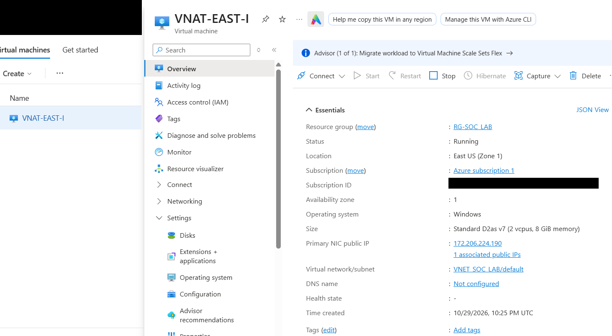
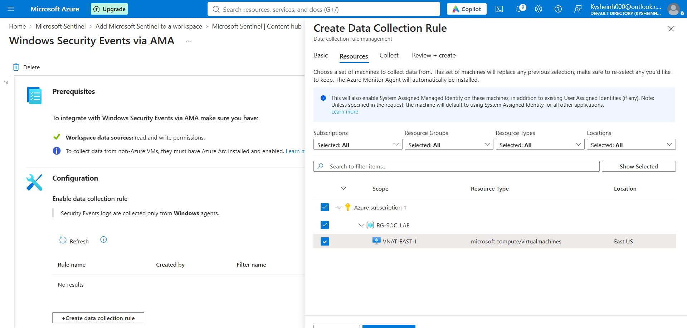
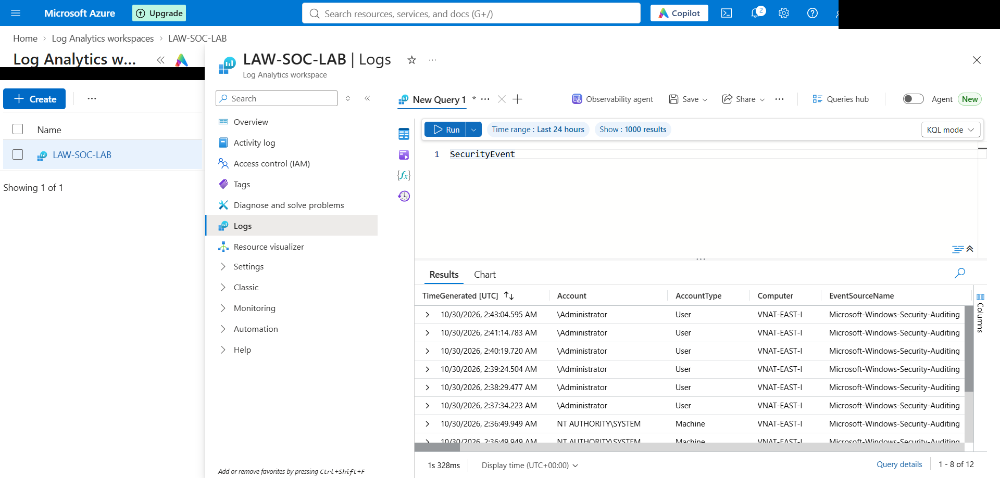
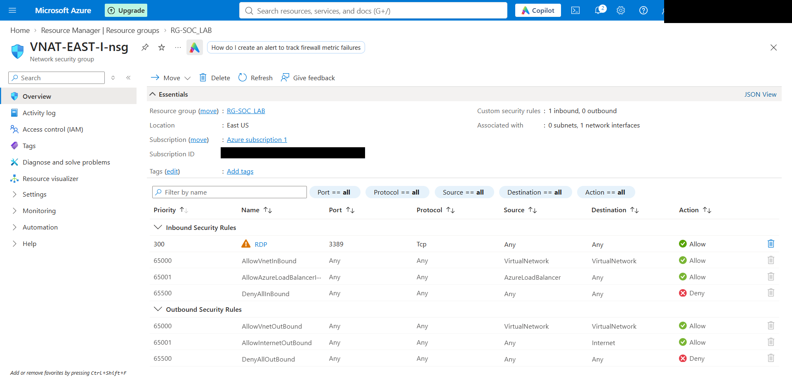
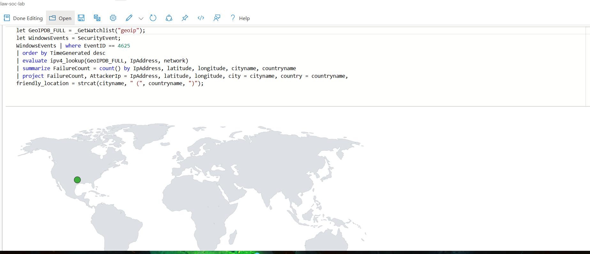
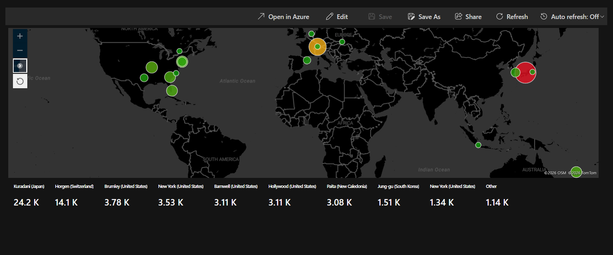

# Azure Sentinel Honeypot and Attack Map

A hands-on Azure security monitoring lab focused on collecting Windows failed sign-in events, querying them with KQL, enriching source IP addresses with GeoIP data, and viewing the results in a Microsoft Sentinel workbook.

## Project overview

I deployed a Windows virtual machine in Azure as a honeypot lab, sent Windows security events to a Log Analytics workspace, and used Microsoft Sentinel to investigate failed logons and visualize source locations.

The screenshots and notes from the lab show a Log Analytics workspace named `LAW-SOC-LAB`, a Windows Security Events via AMA data collection setup targeting the VM, queries for Windows Event ID `4625`, and a Sentinel attack map workbook.

## What I worked on

- Set up an Azure virtual machine and its network security group for the lab.
- Generated failed sign-in activity and reviewed the corresponding Windows Security events.
- Connected Windows Security Events to Log Analytics through Azure Monitor Agent (AMA) and a data collection rule (DCR).
- Queried failed logons with Kusto Query Language (KQL), including timestamps, event details, source IP, and account name.
- Enriched source IP data using a Sentinel watchlist containing GeoIP network ranges and the `ipv4_lookup()` function.
- Built a Microsoft Sentinel workbook to map observed source locations.

## Data flow

`Azure Windows VM` → `Azure Monitor Agent + DCR` → `Log Analytics SecurityEvent` → `Microsoft Sentinel` → `GeoIP watchlist + workbook map`

## KQL examples

### Find failed logons

See [`queries/failed-logons.kql`](queries/failed-logons.kql). The query filters SecurityEvent records to Event ID 4625 and selects the fields used during review.

### Enrich failed logons with GeoIP data

See [`queries/geoip-enrichment.kql`](queries/geoip-enrichment.kql). This example uses the Sentinel watchlist alias `geoip` and matches source IP addresses to network ranges. It requires the watchlist and `SecurityEvent` data to exist in the workspace.

## Tools and services

- Microsoft Azure Virtual Machines
- Network Security Groups
- Azure Monitor Agent and Data Collection Rules
- Log Analytics
- Microsoft Sentinel
- Kusto Query Language (KQL)
- Sentinel Watchlists and Workbooks

## Security note

This was an isolated learning lab. The exercise used permissive inbound access and disabled the Windows firewall to generate observable activity. Those settings are unsafe for a production system. Do not copy them to an internet-facing or business system; use a controlled lab and remove or secure cloud resources when finished.

## Screenshots

The screenshots below document the lab setup, log collection, and attack map. Account details and the Azure subscription ID have been redacted. The VM overview leaves the honeypot's public IP visible as requested.

### Azure virtual machine

### Windows event collection

### Network security rule

### Sentinel attack map

### Attack map after 15 hours

The workbook map shows failed sign-in activity grouped by geolocation after 15 hours of honeypot data collection.

## About

This project demonstrates practical exposure to cloud log collection, basic SIEM investigation, KQL, event enrichment, and security event visualization. It is a lab project, not a production deployment.
